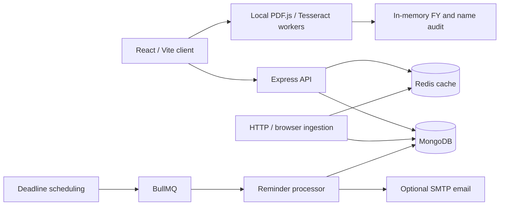

# Udaan Scholarship Finder

Udaan helps Indian students discover scholarships, review recorded eligibility criteria and source evidence, prepare documents, and manage saved opportunities and deadline reminders.

[Frontend](https://udaan-scholarships.vercel.app/) · [Backend](https://udaan-scholarship-finder.onrender.com)

These are deployment links. A successful local build does not establish their current availability.

## Implemented features

- Scholarship search, filters, scheme details, official application links and calendar exports.
- Source-specific ingestion adapters using HTTP/Cheerio with bounded Playwright rendering where required. Eleven enabled source configurations cover selected government and foundation pages; configuration does not establish complete portal coverage or a successful current crawl.
- Stored source snapshots, verbatim excerpts, source URLs, observed changes and academic-year application cycles. The evidence endpoint checks excerpts against stored snapshots; it does not certify a provider or guarantee current application terms.
- A deterministic recursive policy evaluator with **AND, OR, NOT and conditional branches**, using passed/failed/unknown logic. Existing flat conditions remain an implicit AND. Alternative routes are shown as groups, and the profile form accepts marks percentage separately from CGPA. [Rule format, safeguards and demo](backend/RULE_ENGINE.md). Recorded criteria can be incomplete; match percentages are a rule-based heuristic, not award probability or an ML prediction.
- Browser-local PDF.js text extraction and English Tesseract OCR. Students edit extracted fields and explicitly choose which supported fields to carry into eligibility.
- A private pre-submission auditor: India-time financial-year freshness, stated validity and explainable name comparisons across up to six reviewed document names. Initials, missing middle parts, spelling variations and substantial differences produce advisory observations. Comparison names stay in memory and clear when the scanner is left. [Design, privacy boundaries and demo](frontend/SCANNER.md#private-pre-submission-auditor).
- Bookmarks, in-app notifications, alert preferences and optional SMTP email. BullMQ job IDs and database keys reduce duplicate notification records; delivery depends on service availability and does not provide an exactly-once email guarantee.
- Opt-in personalized eligibility-change alerts for saved schemes: compare source-backed rule versions against the same saved profile, explain changed checks with old/new evidence, and retain pending events for retry. [Design, limitations and offline demo](backend/ELIGIBILITY_ALERTS.md).
- Redis response and eligibility caching with shared enum normalization in queries and cache keys, invalidation after catalogue changes, request limits and protected account/admin endpoints.

## Eligibility and evidence semantics

Missing demographic and numeric inputs remain unknown. Empty strings are not zero income or zero marks. Disability has explicit yes, no and unknown states. **National schemes only** filters the catalogue to all-India listings; it does not establish a student's domicile or satisfy a state-specific domicile rule.

Source quotations retain their original text and links. Generated rule explanations and general descriptions are not quotations. A verified excerpt means the evidence endpoint matched it to a stored source snapshot. Stored excerpts not rechecked, or failing verification, are labelled **Not verified**.

Document items with item-specific source excerpts can be labelled as source-cited instructions. Inferred and older uncited lists are preparation suggestions; their `mandatory` flags do not establish official requirements or count toward required-document readiness. Preparation checklists do not invent universal financial-year cutoffs, certificate formats or rejection rules. Confirm the provider's current instructions.

## Document privacy

Scanner files, OCR text and extracted details are processed inside the browser. The scanner does not upload documents. PDF/OCR workers and supporting assets are self-hosted. It supports English PDF, PNG and JPG files up to 10 MB and PDFs up to five pages; image, text and execution limits also apply.

A requested download saves a review on the user's device. The optional eligibility handoff requires selecting fields and acknowledging server use. Eligibility submissions send profile answers to the backend; signed-in submissions also update the saved profile. Checklist progress is browser-local. This is browser-local document processing, not a claim of cryptographic zero-knowledge verification, authenticity or guaranteed acceptance.

See [scanner behavior and tests](frontend/SCANNER.md), [feature access](frontend/ACCESS.md) and [ingestion behavior and coverage](backend/INGESTION.md).

## Architecture



MongoDB holds users, profiles, scholarships, snapshots, cycles, versions and notification records. Failed or unverified crawls preserve existing records and report issues. Cron schedules run while the host is running. Redis failure can fall back to database reads; this does not imply high availability or measured performance.

## Local setup

Use Node.js 22 and npm (the runtime used for local checks and CI), MongoDB, and optionally Redis and SMTP.

1. Run `npm ci` in the repository root, `backend/` and `frontend/`.
2. Create `backend/.env` with your MongoDB connection, JWT signing secret, frontend origin, and optional Redis/SMTP/Google sign-in configuration. Never commit credentials.
3. Set frontend `VITE_API_URL` to your backend origin or `/api` endpoint. Without it, the development client uses `http://localhost:5000/api`.
4. From `backend/`, run `npm run pipeline:browser:install` when using rendering. See the ingestion guide for Linux/Render setup.
5. Run `npm run dev` from the root, or run each service's `npm run dev` separately.

Backend environment names include `PORT`, `NODE_ENV`, `MONGO_URI`, `JWT_SECRET`, `FRONTEND_URL`, `REDIS_URL`, `SMTP_HOST`, `SMTP_PORT`, `SMTP_USER`, `SMTP_PASS`, `EMAIL_FROM` and `GOOGLE_CLIENT_ID`. Configure the services you actually use.

## Checks and builds

Public scholarship titles can be translated on demand with automatic source-language detection. See [translation setup and provider limits](backend/TRANSLATION.md) for Google Cloud configuration and the best-effort demo fallback. Official titles and evidence remain intact.

From `backend/`:

```sh
npm test
npm run test:pipeline:browser
```

The first command runs isolated unit and ingestion integration tests. The second uses a real browser against a synthetic local portal. Neither establishes current live portal availability. Run live checks separately using the ingestion guide.

From `frontend/`, install the test browser once:

```sh
npx playwright install chromium
```

An installed Chrome or Edge can alternatively be selected with `PLAYWRIGHT_CHANNEL=chrome` or `msedge`. On PowerShell, set `$env:PLAYWRIGHT_CHANNEL='msedge'` before running checks.

```sh
npm run check
npm run test:scanner:ui
```

`check` runs lint with zero warnings allowed, all frontend unit tests, the production build and application browser smoke checks. `npm run build` alone builds the app and its self-hosted scanner assets. The smoke journey covers homepage, scholarships, source evidence, eligibility and scanner on desktop and mobile, plus empty-evidence and missing-input regressions. API responses are synthetic; production accounts and document uploads are not used. The scanner suite also exercises actual local PDF/OCR processing, privacy, cancellation, the pre-submission auditor and handoff.

GitHub Actions repeats backend tests and frontend checks on pushes and pull requests, and runs the scanner browser suite. Reminder regressions execute the processor used by the BullMQ worker with isolated dependencies; they do not copy its decision logic or dispatch real emails.

## Project layout

Source navigation keeps the fetched URL on every quotation for snapshot verification. Scholarship-specific pages and guideline PDFs are discovered within the matching listing block, constrained to the source's allowed domains and existing follow-up budget. A `detailUrl` is stored separately from the shared listing URL; ambiguous duplicate titles never borrow another card's documents. PDF citations open the cited page, myScheme API citations link to the exact public slug with a separate raw-data link, and shared HTML listings use browser text fragments to locate the scholarship. Some providers expose only a shared page or JavaScript interaction, so passage navigation depends on browser/provider support. Existing records gain the richer discovery links on their next crawl; the modal can already recover myScheme public pages from saved evidence.

- `backend/src/pipeline/`: sources, adapters, fetching, normalization, evidence and storage.
- `services/gazette/`: optional Python/FastAPI public-guideline PDF service with table geometry, clause hierarchy, metadata candidates, OCR and bounded worker processes. [Setup, contract and verification](services/gazette/README.md). Enable with `GAZETTE_SERVICE_URL`; failures fall back to `pdf-parse` and enter the ingestion-issue queue. Student document scanning remains browser-local.
- `backend/src/engine/`: eligibility condition evaluation.
- `backend/src/workers/`: BullMQ wiring and tested reminder processor.
- `backend/src/models/`, `controllers/`, `routes/`: persistence and API behavior.
- `frontend/src/pages/`, `components/`: application UI.
- `frontend/src/scanner/`: document processing and review.
- `frontend/src/utils/`, `hooks/`: shared logic and presentation helpers.
- `backend/test/`, `frontend/test/`: regression and browser tests.

## License and credits

Font assets include their respective licenses in `frontend/src/assets/fonts/`. Source circulars and terms belong to their issuing providers. Udaan is a discovery and preparation aid; applications and official decisions remain with those providers.
