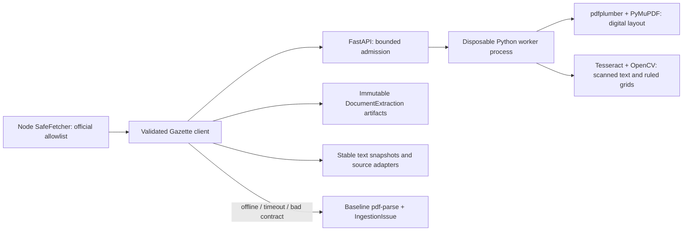

# Official Gazette Document Intelligence

Internal FastAPI service for **public official guideline PDFs** fetched by Udaan's existing allowlisted crawler. It never receives student certificates or scanner uploads. There is no URL-fetch endpoint, external OCR provider, LLM, or document retention in the service.

## Run

From the repository root:

```powershell
docker compose -f services/gazette/compose.yaml up --build -d
```

Add to the backend's existing environment and restart the backend/crawler:

```dotenv
GAZETTE_SERVICE_URL=http://127.0.0.1:8000
GAZETTE_TIMEOUT_MS=90000
# Optional: set the same GAZETTE_API_KEY on the service and backend.
```

An empty `GAZETTE_SERVICE_URL` disables delegation and keeps the baseline parser. A configured but unavailable service produces an ingestion issue and falls back. No live crawl or database migration is required to test the service.

Docker publishes only on loopback. For containers on a shared private network use `http://gazette:8000`. Keep this internal; it is not a student upload API. The optional shared key is checked on extraction requests. `/healthz` reports ASGI liveness; `/readyz` checks Tesseract and the default language packs.

Native Python 3.12+ is also supported: create a virtual environment, install `requirements.txt`, install Tesseract and language packs, and run `python -m uvicorn gazette.app:app --host 127.0.0.1 --port 8000` from this directory. Docker includes English, Hindi, Telugu, Tamil, Marathi, Bengali, Gujarati, Kannada, Malayalam, Punjabi and Odia packs. Default OCR is `eng+hin`; select source-specific languages explicitly, for example:

```js
// Source registry configuration; entry.gazette can override this per PDF.
gazette: { ocrLanguages: "eng+tel" }
```

There is no script-based language guess. A missing language pack produces a page warning or an unreadable-document error, followed by Node's fallback.

## Contract

`POST /v1/extract?ocr_languages=eng` accepts raw `application/pdf` bytes, not JSON URLs or multipart student files. Optional headers: `X-Document-SHA256` (checked against bytes), `X-Gazette-Key`. FastAPI exposes the response schema in `/docs` and `/openapi.json`.

```powershell
curl.exe --fail-with-body -H 'Content-Type: application/pdf' --data-binary '@services/gazette/tests/fixtures/layout.pdf' 'http://127.0.0.1:8000/v1/extract?ocr_languages=eng'
```

Response version `1.0` includes:

| Field | Meaning |
| --- | --- |
| `source_sha256`, `byte_length`, `profile_sha256` | Original byte identity and extraction settings identity. Rotation normalization affects only the working copy. |
| `text`, `pages[]` | Reading-order text, page boundaries, words, line boxes, digital/OCR method and OCR word confidence. |
| `tables[]` | Page, geometry, rows, cells, row/column spans and source word indices. Covered slots of merged cells are `null`; an actual empty cell is `""`. |
| `sections[]` | Flat hierarchy with `parent_id`, level, source heading, kind, text range and pages. Parent ranges include children. `Preamble` is a generated label with `heading_text: null`. |
| `metadata` | Candidate notification numbers, issuing authorities and deadline dates with exact quote, page, box and offsets. |
| `warnings`, `requires_review`, `status` | Explicit OCR/reconstruction problems and complete/partial extraction status. |

Offsets are **UTF-16 code units**, matching JavaScript `String.slice`, including non-BMP characters. Page numbers are one-based. All boxes use `[x0, y0, x1, y1]` in PDF points (1/72 inch), top-left origin in the normalized display orientation. Word indices and cell row/column indices are zero-based within a page/table. OCR confidence is Tesseract's recognition score, not a calibrated policy-correctness probability.

The Node Zod boundary validates the version, byte hash/length, dimensions, cell references, nonoverlapping cells, hierarchy and exact quote/offset agreement. Invalid responses never become evidence.

## Processing and isolation



CPU parsing runs in separate processes; declaring a route `async` does not make PDF/OCR work nonblocking. Each admitted job gets a temporary directory and worker, removed after success, error, cancellation or timeout. Worker termination also kills its Tesseract descendants. Admission rejects excess work with `503`; it does not build an unbounded memory queue. The container runs as a non-root user with a read-only filesystem and a bounded `/tmp`.

Defaults: 20 MiB upload, 60 pages, 2 active workers, 15-second upload budget, 75-second document budget, 12-second OCR budget per page, 180 DPI, 12 million rendered pixels per page, 1 million text units, 4 MiB result. Each is a `GAZETTE_*` setting defined in `gazette/config.py`. Node's timeout includes reading the response body; two consecutive transient failures open a 30-second circuit breaker. HTTP redirects are not followed. No automatic retry repeats an expensive job.

Digital pages use pdfplumber ruled tables, with a labelled text-alignment heuristic when no rules are found. Scanned pages use Tesseract word boxes and OpenCV line morphology for ruled grids. Sparse digital headers over large scan images also trigger OCR. Recursive whitespace cuts preserve common two-column reading order. Whole-page rotated digital PDFs are normalized before both engines read them.

## Interpretation limits

- Section kinds and metadata are deterministic heuristics. Unrecognized/regional headings can remain `other`; source text and geometry are retained. This is not legal interpretation or official authentication.
- Numeric dates such as `01/02/2027` remain ambiguous (`iso_date: null`) unless their order is unambiguous. A stated deadline is a candidate, never an automatically updated application cycle.
- All reconstructed tables and OCR text require review. The existing guideline adapter withholds automated amounts/income/disability thresholds for these documents. They are available as structured evidence for a later reviewed mapping workflow.
- Unruled scanned tables, severely skewed photographs, stamps obscuring numbers and unusual nested layouts are not guaranteed. OCR cannot recover unreadable pixels. No inferred value is substituted for missing text.
- Partial results retain readable pages and warnings. Node first tries baseline extraction; if baseline yields no text, the readable partial service text is retained with review required. If neither extractor can read a guideline, the issue is recorded and existing scholarship values and snapshots remain intact. A completely unreadable **required catalogue source** is still reported as failed rather than fabricated as a successful empty catalogue; other sources can continue.

Rich results live in MongoDB `DocumentExtraction`, keyed by URL and extraction content hash. Repeated artifacts only update `lastSeenAt`. Text snapshots keep their existing deduplication and citation offsets; each crawl page records its artifact ID. HTTP 304 replay restores the latest matching artifact without sending cached text as PDF bytes. New extractor profiles can be archived even when visible text is unchanged. Public scholarship provenance does not embed full OCR text/geometry.

## Verify

```powershell
docker build --target test -t udaan-gazette:test services/gazette
docker run --rm --init --mount "type=bind,source=$((Resolve-Path services/gazette).Path),target=/app" udaan-gazette:test
npm test --prefix backend
# With the service running; fixtures are explicitly synthetic.
npm run test:gazette --prefix backend
```

Python tests exercise actual pdfplumber/PyMuPDF parsing, actual Tesseract OCR, scanned grid reconstruction, mixed digital/scan PDFs, columns, merged cells, hierarchy, rotation, ambiguous/invalid dates, encrypted/malformed files, upload/page/render limits, worker overload, responsiveness and timeout cleanup. Node tests cover transport/contract failures, stalled bodies, circuit recovery, fallback, full recorded crawls, unchanged verified values, artifact retention and 304 replay. The explicit HTTP suite exercises Python -> Zod -> Node pipeline -> snapshot/evidence storage using the real running service. These checks do not establish accuracy on every NSP or state circular or measure production throughput.

The fixtures are generated by `tests/fixture_factory.py` and marked as test documents. No personal documents are used. Dependencies are pinned in `requirements*.txt`. PyMuPDF has AGPL/commercial licensing; see its [license documentation](https://pymupdf.readthedocs.io/en/latest/about.html#license-and-copyright) when distributing the service. Relevant implementation references: [pdfplumber tables](https://github.com/jsvine/pdfplumber#extracting-tables), [PyMuPDF multiprocessing](https://pymupdf.readthedocs.io/en/latest/recipes-multiprocessing.html), [pytesseract geometry and timeouts](https://github.com/madmaze/pytesseract).
